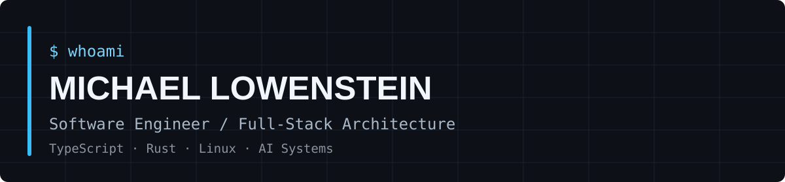
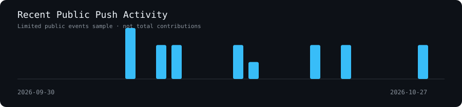

### Full-Stack Engineering · Systems Architecture · AI Tooling

Building reliable software, developer platforms,
and practical AI-assisted engineering systems.

---

## About Me

I'm a full-stack software engineer working across
complex application architectures, production systems,
developer tooling, and AI-assisted workflows.

My work focuses on making large software systems
easier to understand, investigate, maintain, and extend.

**Engineering interests**

- Full-stack architecture with TypeScript, Node.js, Python & .NET Core 
- Angular, React, Vue and modern frontend systems
- Rust, Linux, and systems-level development
- LLM integration, agents, and AI-assisted tooling
- Production diagnostics and data integrity
- Developer productivity and platform engineering

---

## Technology Stack

### Languages

### Frontend & Backend

### Infrastructure & Tooling

---

## Engineering Focus

| Area | Focus |
|------|-------|
| Architecture | Maintainable, scalable full-stack systems |
| AI Engineering | LLM integration, agents, and validated tooling |
| Platform Engineering | Developer productivity and domain intelligence |
| Systems | Rust, Linux, automation, and performance |
| Production | Diagnostics, data integrity, and reliability |

---

## Selected Engineering Work

### Developer Platform Intelligence

Building tools that make complex codebases
and domain-specific systems easier to navigate,
investigate, and understand.

**Areas:** TypeScript, LLMs, code intelligence,
structured metadata, validation.

### Agentic Evaluation Systems

Exploring evaluation frameworks, reproducible
workflows, and failure analysis for AI agents.

**Areas:** TypeScript, agentic workflows,
testing, evaluation, automation.

### Rust + TypeScript Engineering

Developing practical tools in parallel implementations
to compare language design, runtime behavior,
type systems, and engineering tradeoffs.

**Areas:** Rust, TypeScript, CLI tooling,
systems programming.

---

### Additional Frameworks & Languages

---

## Developer Workflow

I work primarily in Linux-based development environments, with an emphasis on reproducibility, automation, and efficient navigation across large codebases.

**Core tooling:** Git, Docker, SSH, terminal multiplexers, shell scripting, CI/CD, automated testing, and developer-focused CLI utilities.

**Working approach:**

- Keep build, test, and deployment workflows reproducible.
- Validate assumptions against source code, schemas, and execution evidence.
- Automate repetitive investigation and development tasks.
- Prefer structured knowledge and deterministic validation over unsupported AI-generated conclusions.
- Design tools around actual engineering workflows rather than isolated demonstrations.

---

## Architecture & Engineering Approach

| Discipline | Approach |
|---|---|
| Full-Stack Engineering | Clear boundaries, maintainable APIs, and type-safe application design |
| Platform Intelligence | Structured domain knowledge backed by validated implementation details |
| AI Engineering | Evidence-grounded LLM integration, agent orchestration, and output validation |
| Production Engineering | Root-cause investigation, data-integrity remediation, and regression prevention |
| Developer Tooling | Practical automation, repository navigation, and reusable workflows |
| Quality Engineering | Repeatable tests, explicit failure handling, and traceable results |

---

## Featured Engineering Projects

| Project | Focus | Technologies |
|---|---|---|
| Onboarded | Platform intelligence and navigation across complex application ecosystems | TypeScript, LLMs, structured metadata |
| Agentic Evaluation Platform | Reproducible agent evaluation, orchestration, and evidence-backed reporting | TypeScript, Node.js, automation |
| Rust + TypeScript Projects | Practical utilities implemented in parallel to explore language and runtime tradeoffs | Rust, TypeScript, CLI |

---

## Current Engineering Interests

- Reliable AI-assisted development systems and agent orchestration
- Rust for practical systems and developer tooling
- Linux automation and terminal-driven productivity
- Developer platforms built around structured, validated domain knowledge
- Full-stack architectures combining modern frontend frameworks and typed backend services

---

> Understand the system. Validate assumptions. Automate repeatable work. Build tools that last.

---

## GitHub Activity

---

**Engineering · Architecture · Developer Tooling**

